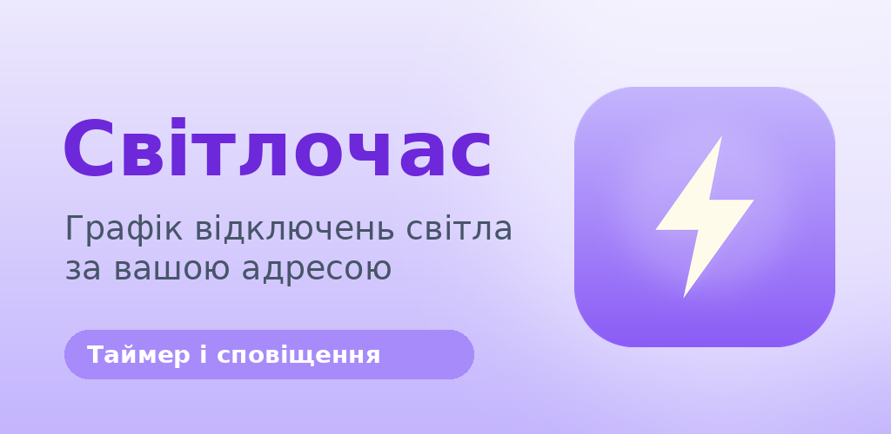

  

# Світлочас

**Світлочас** показує графік відключень світла за конкретною адресою в Україні та нагадує про вимкнення заздалегідь.

[English](README.md)

## Що це

Планові та екстрені відключення електроенергії стали частиною повсякдення. Кожне обленерго публікує графіки по-своєму: сторінка сайту, картинка, PDF або чат-бот. Світлочас збирає ці дані в одному місці й дає просту відповідь на одне запитання: *коли не буде світла за моєю адресою?*

## Для кого

- для мешканців України, які планують день, роботу та зарядку пристроїв з урахуванням відключень
- для українців за кордоном, які дбають про рідних і житло в Україні
- для тих, кому потрібен графік одразу для кількох місць, наприклад дім, офіс і батьки

## Як це працює

1. Сервер регулярно читає відкриті джерела операторів систем розподілу та зводить графіки до єдиного формату.
2. Користувач обирає регіон та адресу або чергу, якщо вже знає її.
3. Застосунок показує графік на сьогодні й завтра по годинах і таймер до найближчого вимкнення або ввімкнення.
4. Нагадування плануються на самому пристрої, тому надходять навіть тоді, коли застосунок закрито.
5. Якщо графік змінився протягом дня, застосунок показує, що саме змінилося.

Реєстрація не потрібна. Список адрес зберігається лише на пристрої користувача.

## Що доступно

| | |
|---|---|
| Застосунок для Android | графік за адресою, таймер, нагадування, історія змін, віджет на головному екрані |
| Веб-версія | графік за адресою або чергою з оновленням наживо |
| Покриття | 19 регіонів України, у більшості з них є пошук за адресою |

Проєкт активно розвивається і ще не опублікований у магазинах застосунків.

## Репозиторії

| Репозиторій | Призначення |
|---|---|
| `api` | сервер: збір даних, REST API та оновлення наживо |
| `app` | застосунок для Android на Flutter |
| `web` | веб-клієнт |
| `docs` | документація та матеріали для магазину |
| `utils` | інструменти для досліджень |

## Застереження

Світлочас є неофіційним сервісом. Він не повʼязаний з ДТЕК, Укренерго чи іншими енергокомпаніями. Дані беруться з відкритих джерел операторів систем розподілу й можуть оновлюватися із затримкою. Фактичний час відключень може відрізнятися від опублікованого графіка.

## Видавець

Korysnyk LTD, Англія та Уельс, реєстраційний номер 16942523
Сайт: [svitlochas.care](https://svitlochas.care)
Контакт: admin@korysnyk.care
